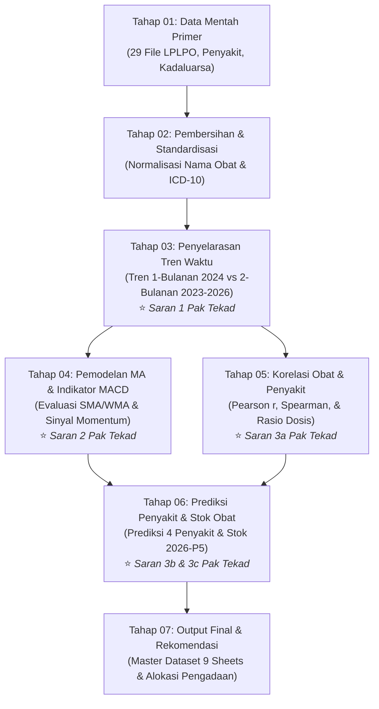

# 🏥 Alur Pengolahan Data: Dari Data Mentah Hingga Final Output
### **Implementasi Komprehensif Rekomendasi Dosen Pembimbing (Pak Tekad Matulatan)**
**Proyek Penambangan Data (INF11121) — Kelompok 23 (Semester Ganjil 2026/2027)**  
*UPTD Puskesmas Teluk Sasah, Kabupaten Bintan, Kepulauan Riau*

---

## 🎯 Peta Jalan Alur Tahapan Data (Data Pipeline Stages)

Seluruh berkas data telah disusun secara terurut per folder sesuai dengan siklus data science dan arahan dosen pembimbing:



---

## 📂 Panduan Rinci Setiap Folder Tahapan

| No | Folder Tahapan | Deskripsi Berkas & Isi Utama | Relevansi Saran Dosen |
| :---: | :--- | :--- | :--- |
| **01** | [`Tahap_01_Data_Mentah_Primer`](Tahap_01_Data_Mentah_Primer/) | Arsip asli 29 berkas LPLPO Excel (2023–2026), rekap 10 diagnosis penyakit (45 bulan s/d Sep 2026), dan berita acara audit fisik obat kadaluarsa. | Sumber data primer asli (*immutable*). |
| **02** | [`Tahap_02_Pembersihan_dan_Standardisasi`](Tahap_02_Pembersihan_dan_Standardisasi/) | 15.781 baris transaksi bersih, 450 rekap penyakit terstandarisasi ICD-10, 138 obat kadaluarsa tervalidasi (Rp 43,3 Jt), dan analisis kuantifikasi 482 kejadian *stockout* nyata. | Standardisasi entitas, eliminasi *noise*, & audit fisik. |
| **03** | [`Tahap_03_Tren_1Bulanan_dan_2Bulanan`](Tahap_03_Tren_1Bulanan_dan_2Bulanan/) | Matriks 12 bulan 2024, matriks 22 periode dwibulanan kontinu, matriks pivot obat, dan analisis komparasi CV *fair* (Apple-to-Apple) 2024. | **Saran 1**: Menampilkan dan membandingkan tren 1 bulanan vs 2 bulanan. |
| **04** | [`Tahap_04_Pemodelan_MA_dan_Indikator_MACD`](Tahap_04_Pemodelan_MA_dan_Indikator_MACD/) | Evaluasi galat SMA-2, SMA-3, WMA-3 (MAPE/MAE/RMSE) untuk 150 obat aktif, analisis momentum MACD (2/4/2), dan benchmarking Machine Learning (HistGradientBoosting & Ridge). | **Saran 2**: Algoritma MA, analisis indikator momentum MACD, dan benchmarking ML. |
| **05** | [`Tahap_05_Korelasi_Obat_dan_Penyakit`](Tahap_05_Korelasi_Obat_dan_Penyakit/) | Koefisien korelasi Pearson/Spearman antara ISPA, Hipertensi, Dispepsia, Diabetes dengan obat terkait serta rasio dosis konsumsi per kasus. | **Saran 3a**: Mencari korelasi antara penyakit dan konsumsi obat. |
| **06** | [`Tahap_06_Prediksi_Penyakit_dan_Stok_Obat`](Tahap_06_Prediksi_Penyakit_dan_Stok_Obat/) | Peramalan 4 penyakit utama, proyeksi obat berbasis penyakit, peramalan stok 2026-P5 (+Safety Stock 95%), indeks musiman empiris, & validasi parsial P5. | **Saran 3b & 3c**: Prediksi penyakit terbanyak dan prediksi stok obat. |
| **07** | [`Tahap_07_Output_Final_dan_Rekomendasi_Pengadaan`](Tahap_07_Output_Final_dan_Rekomendasi_Pengadaan/) | Master Workbook Excel Terpadu (9 Sheets), prioritas pengadaan P1/P2/P3, mitigasi kerugian kadaluarsa, & ringkasan eksekutif laporan. | Luaran strategis terpadu untuk mitra dan ujian akhir. |

---

## 📑 Dokumen Khusus & Catatan Metodologi
* [`CATATAN_LIMITASI_DAN_METODOLOGI.md`](CATATAN_LIMITASI_DAN_METODOLOGI.md): Catatan transparansi ilmiah mengenai sifat data penyakit *top-censored* (10 besar), klarifikasi 138 item kadaluarsa, anomali Fero Sulfat 119.120 tablet (program gizi sekolah), parameter MACD deskriptif, dan hasil benchmarking Machine Learning 10-fold walk-forward.
* [`CATATAN_KOREKSI_DATA_TERSENSOR_PARACETAMOL.md`](CATATAN_KOREKSI_DATA_TERSENSOR_PARACETAMOL.md): Dokumentasi dan justifikasi matematis imputasi permintaan tersensor (*Censored Demand*) Parasetamol 500 mg pada 2026-P4 (Total Stockout) yang mengoreksi alokasi pengadaan menjadi 7.487 tablet.

---

## 🛠️ Reproduksibilitas Skrip Otomatis
Seluruh berkas pada ketujuh folder di atas dihasilkan secara otomatis melalui skrip:
```bash
# 1. Pipeline pembangun alur utama dari data mentah ke final
.venv/bin/python3 04_Skrip_Pengolahan/6_bangun_alur_data_mentah_ke_final.py

# 2. Skrip perbaikan audit & pengayaan analisis lanjutan
.venv/bin/python3 04_Skrip_Pengolahan/7_perbaikan_audit_claude.py
```
Dapat dijalankan kapan saja untuk memutakhirkan dataset dengan satu kali eksekusi (*single-command execution*).
